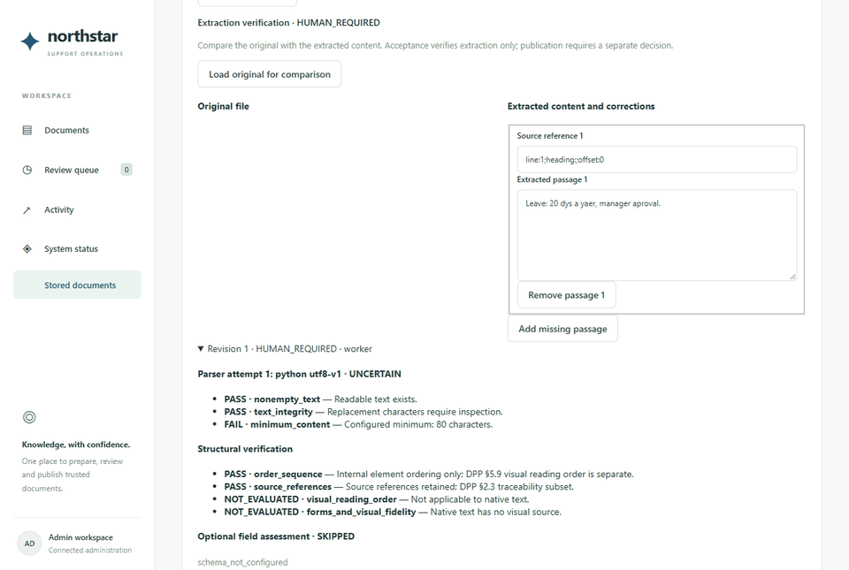
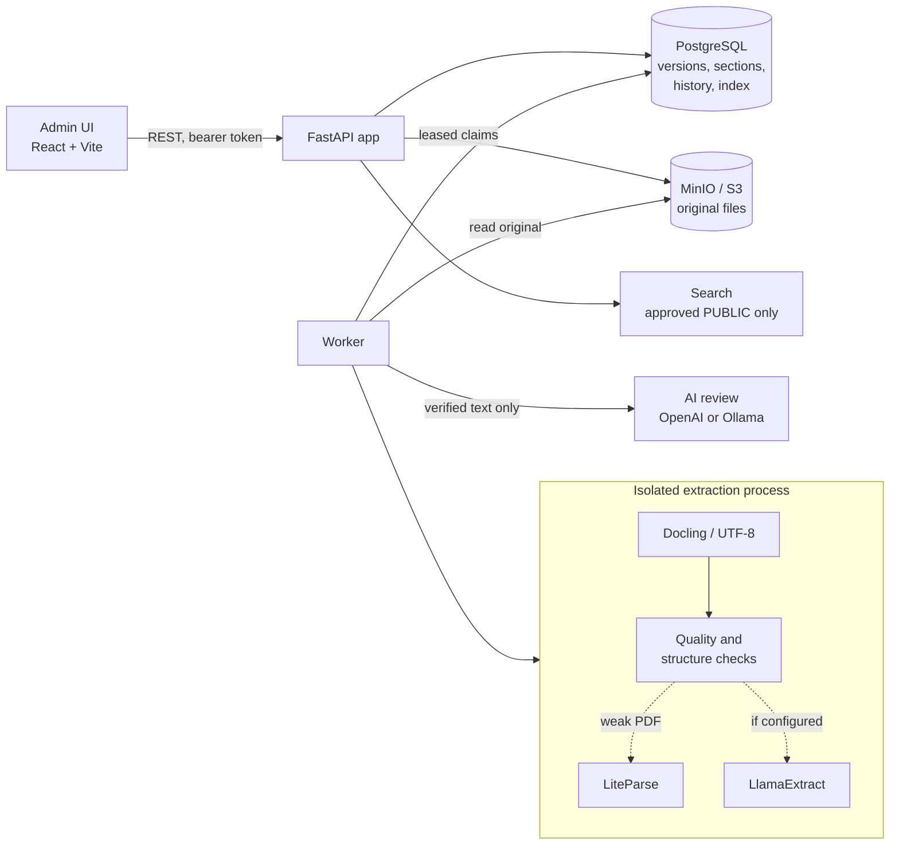

# Northstar — AI Support Operations Platform

Northstar is the backend and admin console for an AI-assisted customer-support
operation. Its knowledge pipeline turns uploaded policy documents (PDF, DOCX,
Markdown, text) into trustworthy, citable evidence for support answers. Each version
is stored privately, parsed, checked for extraction quality, optionally assessed by an
AI reviewer, and published to search **only after a human approves it**.

The platform also includes a simulated SaaS billing domain (accounts, plans, invoices,
refunds) and an authenticated support-case API. Sensitive material is protected by
policy: documents are classified at upload, and that classification decides whether any
text may leave the machine. Highly Restricted content never reaches a cloud service.



## Features

- **Upload and versioning:** single, replacement and batch uploads; explicit policy versions; duplicate detection by file and text fingerprints.
- **Private storage:** originals in S3-compatible storage (MinIO locally) under random keys, with the hash checked on every read.
- **Extraction:** Docling for PDF/DOCX and UTF-8 decoding for TXT/MD, keeping page, heading and table references.
- **Verification:** quality checks, a local LiteParse fallback for weak PDFs, structure checks based on the Document Parsing Protocol, and optional LlamaExtract field confidence.
- **Human verification:** accept, correct, reject or reprocess an extraction; every revision is kept.
- **AI review:** OpenAI or a local Ollama model (Qwen3-4B) flags documents needing attention, with quotes checked against the source. It never approves anything.
- **Publication and search:** approve, reject or request changes; only approved PUBLIC versions enter a local semantic + keyword index.
- **Support cases and billing:** customer case API with lifecycle and retries; simulated billing rules for refunds and plan changes.

## Tech stack

| Layer | Technology |
| --- | --- |
| API | Python 3.12, FastAPI, Pydantic |
| Data | PostgreSQL, SQLAlchemy 2, Alembic |
| Files | MinIO / S3 (`boto3`) |
| Document parsing | Docling, LiteParse, LlamaExtract (optional, cloud) |
| AI review | OpenAI Responses API or Ollama + Qwen3-4B |
| Search | Local TF-IDF + SVD (LSA) with keyword scoring (NumPy) |
| Frontend | React 19, TypeScript, Vite |
| Tooling | pytest, Vitest, Ruff, Docker Compose, GitHub Actions |

## Architecture



A document moves through three independent gates, each of which can stop it:

```text
extraction verification ─► AI review (advisory) ─► human publication decision
   automatic or human          never approves          required for search
```

More detail: [architecture overview](docs/architecture/ARCHITECTURE.md) ·
[extraction verification](docs/architecture/EXTRACTION_VERIFICATION.md) ·
[AI review and storage](docs/architecture/DOCUMENT_REVIEW.md).

## Quick start

**With Docker** (full stack):

```powershell
Copy-Item .env.example .env      # then set the passwords and NORTHSTAR_ADMIN_TOKEN
docker compose up --build --wait
```

Open http://localhost:8080 and choose **Stored documents**.

**Without Docker** (SQLite and a local folder; Python 3.12 and Node 24):

```powershell
py -3.12 -m venv .venv      # must be Python 3.12 (macOS/Linux: python3.12)
.\.venv\Scripts\python.exe -m pip install -r backend/requirements.lock
.\.venv\Scripts\python.exe -m pip install --no-deps --no-build-isolation -e backend
.\.venv\Scripts\python.exe scripts/local_run.py        # API + worker; the token goes to .test-run-local/
cd frontend; pnpm install --frozen-lockfile; pnpm dev   # http://localhost:5173
```

The full guide, including AI review with Ollama or OpenAI, is in
[docs/guides/SETUP.md](docs/guides/SETUP.md).

## Repository layout

```text
.
├── backend/                  Python package "northstar" and its tests
│   ├── northstar/
│   │   ├── retrieval/        documents: upload, extraction, verification, worker, search
│   │   ├── ai/               AI document review: providers, routing, review worker
│   │   ├── cases/            support-case API and lifecycle
│   │   ├── evaluation/       classifier evaluation runner
│   │   ├── migrations/       Alembic schema revisions 0001–0010
│   │   └── *.py              app assembly, config, database, billing domain, storage
│   └── tests/                pytest suite and fixtures
├── frontend/                 React + TypeScript admin console (src/, tests next to components)
├── docs/
│   ├── guides/               setup, configuration, usage, verification runbook
│   ├── architecture/         design of each component
│   ├── project/              implementation contract, status, traceability
│   └── assets/               screenshots and GIFs
├── scripts/                  dev setup and checks, no-Docker runner, demos
├── .github/                  CI workflow, issue and PR templates
├── compose.yaml              PostgreSQL, MinIO, API, worker, frontend, optional Ollama
└── .env.example              every setting, with safe defaults
```

Each app has its own README: [backend](backend/README.md) · [frontend](frontend/README.md).

## Documentation

| I want to… | Read |
| --- | --- |
| Install and run it | [guides/SETUP.md](docs/guides/SETUP.md) |
| Change a setting, or enable LlamaExtract or the AI | [guides/CONFIGURATION.md](docs/guides/CONFIGURATION.md) |
| Take a document from upload to search | [guides/USAGE.md](docs/guides/USAGE.md) |
| Understand a component | [docs/README.md](docs/README.md) (index of all docs) |
| Know what is verified and what isn't | [project/IMPLEMENTATION_STATUS.md](docs/project/IMPLEMENTATION_STATUS.md) |
| Contribute | [CONTRIBUTING.md](CONTRIBUTING.md) |

## Technical challenges

- **No data leaves before policy says so.** The provider is chosen from the document's
  sensitivity *before* any text is sent: Highly Restricted never goes to OpenAI or
  LlamaExtract, and unclassified documents get no AI at all. A failure never quietly
  falls back to another provider.
- **"Not measured" is not "passed".** Parser confidence is reported per rule as PASS,
  FAIL or NOT_EVALUATED, and a missing score can never verify a document. That keeps
  the pipeline honest, at the cost of sending every PDF to a human for now.
- **Holding the AI to its evidence.** The model's JSON is validated strictly. Every quote
  must appear word for word in the section it cites, and a claimed contradiction must
  quote both versions, otherwise the assessment fails.
- **Crash-safe background work without a queue broker.** Claims use leases and fencing
  tokens, so a stalled worker can't overwrite a newer one. Parsing runs in a
  subprocess with a timeout. Sections and status commit in one transaction.
- **Files and database that can't drift apart.** A storage reservation is written before
  each upload, so a crash between the two leaves a record that cleanup can find.
  Reprocessing never modifies the original, and the extraction history is append-only.
- **Separate decisions stay separate.** "The text was extracted correctly" and "this may
  be published" are different approvals by design, so passing one never grants the other.

## Testing

```powershell
python scripts/dev.py check          # lint, backend and frontend tests, production build
```

Backend tests run against SQLite by default. The PostgreSQL concurrency tests need an
empty disposable database (see [guides/VERIFICATION.md](docs/guides/VERIFICATION.md)).
