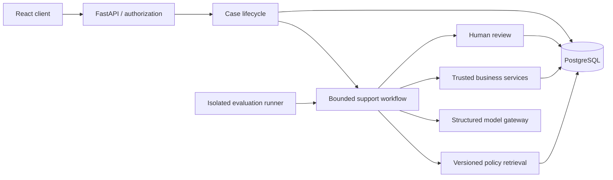

# Northstar Cloud architecture

The intended product is a single FastAPI application, PostgreSQL database, and
React/TypeScript browser client. This is a phased implementation; see
`IMPLEMENTATION_STATUS.md` for what exists today.

API handlers validate transport inputs; services own domain invariants and
transaction boundaries. SQLAlchemy uses short-lived sessions, explicit commits,
and rollback on errors. Alembic owns schema changes; application startup never
silently creates tables. PostgreSQL is the supported runtime database. SQLite is
only a fast test option and does not establish PostgreSQL concurrency correctness.

The model may propose actions, never authorize them. Ownership, eligibility,
policy conditions, and idempotency must be validated in backend services. Business
mutation and audit records must commit together. Customer success messages must
be derived from persisted results. Evaluation will call the same workflow with
isolated fixtures. No live benchmark results exist yet.

Foundation: `backend/northstar` contains configuration, API, database, and logging;
`backend/northstar/migrations` contains packaged revisioned DDL; `backend/tests` contains automated
checks; `frontend` contains the browser client; `docs` contains design and evidence.

Implemented domain: `models.py` holds business entities and operation records;
`domain.py` owns account-scoped transactions and ownership checks; `seed.py`
initializes deterministic synthetic fixtures. The services are currently internal,
with no exposed business API until authentication and case workflow are in place.

C01 responsibility map: API transport and readiness in `api.py`; configuration in
`config.py`; persistence in `db.py` and `models.py`; existing business services in
`domain.py`. The `ai`, `retrieval`, `evaluation`, and `integrations` packages reserve
explicit homes for later features without implementing speculative adapters or
frameworks. Migrations ship inside the Python distribution and are addressed as
`northstar:migrations` by both Alembic and readiness, so installed deployments do
not depend on a neighboring source checkout.
