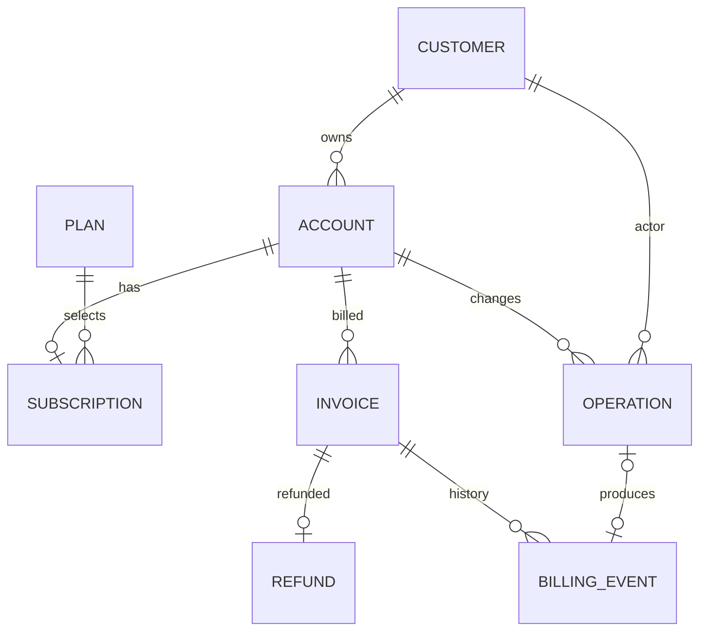

# Northstar Cloud business rules (version 2)

These are simulated SaaS records; no real payments are performed.

- Money is integer minor units, USD only in the initial fixture.
- An account belongs to one customer. Every service receives an authenticated
  customer ID; finding another customer's account returns the same not-found error.
- Accounts are ACTIVE or SUSPENDED. Only active accounts may perform mutations.
  The internal lifecycle service can suspend/reactivate an owned account; this
  explicit exception permits recovery from suspension and records the reason.
- Subscriptions are ACTIVE, PAST_DUE, or CANCELED. Only active subscriptions may
  change to an enabled plan; requesting the existing plan is rejected.
- Internal lifecycle transitions allow ACTIVE to PAST_DUE or CANCELED and
  PAST_DUE to ACTIVE or CANCELED. CANCELED is terminal. This internal service is
  not an additional model tool.
- Plans: Starter $19/month, Growth $49/month, Scale $99/month. Changes update the
  plan only; no proration or payment provider integration is claimed.
- Paid invoices dated no more than 30 days ago are eligible for a single full
  refund up to $100. Future-dated, unpaid, void, and refunded invoices are ineligible.
- Refunds preserve original payment status, persist a separate refund record,
  and set `refunded_minor` atomically. Partial refunds are not supported.
  Refunds include a nonblank reason (maximum 500 characters), COMPLETED state,
  and creation/update timestamps. Only committed simulated refunds have records;
  failures roll back instead of inserting a misleading completed record.
- Invoice lifecycle operations accept only UNPAID → PAID or UNPAID → VOID,
  reject future-dated invoices, and atomically persist billing events with the
  invoice update and operation audit. These are simulated events, not payment
  provider calls. They do not silently reactivate subscriptions or prorate plans.
- A caller-provided idempotency key is scoped to the account. A replay returns the
  persisted result only if operation and arguments match. Reusing a key for
  different arguments is a conflict.
- Each mutation locks the account, then subscription/invoice. Audit and result
  records commit with the mutation. PostgreSQL row locks serialize competing
  requests; unique constraints and conditional updates provide a second guard.

The policy corpus in C03 must agree with these rules. Operator approval cannot
override ownership or financial eligibility. Missing records and conflicting
states are preserved in deterministic fixtures for later evaluation.

## Relationships and history



`BusinessService` owns each mutation transaction. `get_account_history` exposes
account status, subscription status, and plan transitions from existing operation
records, including actor, before/after state, reason where applicable, and time.
`get_billing_history` exposes persisted invoice/payment/refund events.
`get_refunds` exposes refund metadata. All history reads enforce ownership and
pagination. These are internal APIs: a future HTTP/tool layer must supply a
trusted authenticated identity. No support-case state lives in these tables.

Core mutable records have UTC creation/update timestamps. ORM updates and trusted
services update `updated_at`; direct administrative SQL must maintain it explicitly.
Billing events and operation records are append-only through the service API.
Database constraints reject invalid currencies, amounts, states, refund counters,
missing foreign keys, and duplicate invoice refunds. Account/record locking and
eligibility checks remain in trusted code, independently of any future model.

## Reproducible seed/reset

Fixture version: `northstar-business-v2`. Supply an explicit `--as-of` date.
Every seeded ID, value, event, and timestamp is deterministic for that date.

```sh
python -m alembic -c backend/alembic.ini upgrade head
python -m northstar.seed --as-of 2026-10-12
python -m northstar.seed --as-of 2026-10-12 --reset
```

Run from the repository root with the environment configured. Seed refuses any
existing business records. Reset is explicit, restricted to development/test, and
requires the fixture provenance marker. It replaces the entire listed business
baseline in one transaction, including history and idempotency records. It never
drops schema, resets unrelated tables, or cascades into support-case records.
Foreign keys from support records cause a rollback; use a dedicated database per
test/evaluator. Concurrent independent evaluations must not share one database.
On PostgreSQL the marker's exclusive reset lock excludes service mutations, which
hold a shared marker lock. Reset does not coordinate arbitrary administrative SQL.

Databases seeded before revision 0003 have no provenance marker and are deliberately
not automatically eligible for reset. Create a fresh disposable database for v2
fixtures. No existing records are silently adopted or deleted by a migration.

## Scenario inventory

| Records | Scenario |
| --- | --- |
| `alice-active`, `bob-active` | Active customers; cross-account access checks |
| `alice-canceled`, `alice-past-due` | Invalid plan transitions |
| `alice-suspended`, `inv-suspended` | Refund blocked by account state |
| `alice-no-subscription` | Missing subscription and empty billing history |
| `alice-growth` | Different current plan |
| `retired` plan | Disabled plan target |
| `inv-eligible`, `inv-second-eligible` | Multiple eligible invoices; request without an ID is ambiguous |
| `inv-boundary`, `inv-limit` | Inclusive 30-day and $100 boundaries |
| `inv-old`, `inv-over-limit` | Refund window and amount rejections |
| `inv-unpaid`, `inv-void`, `inv-refunded` | Payment/void/prior-refund states |
| `inv-future`, `inv-scheduled` | Conflicting future dates, rejected by service rules |
| `inv-bob` | Another customer's invoice |
| IDs absent from the fixture | Missing account/customer/invoice queries |

The baseline contains two customers, seven accounts, four plans, six subscriptions,
13 invoices, one historical refund, and 25 deterministic billing events. The
fixture marker preserves its version/date. All records are synthetic.

## Migration and verification

Revision 0003 adds metadata and event/provenance tables without rewriting revision
0002. Existing refund dates are retained; unknown historic creation/update times
are backfilled at migration time, and old refunds receive `legacy_refund` reason.
No unobserved historical billing events are fabricated during migration.

SQLite batch migrations recreate tables. The migration connection temporarily
disables FK enforcement, uses an explicit transaction, validates all references
before commit, then restores enforcement. Runtime connections keep FK checks on.
This follows [Alembic's batch-migration requirements](https://alembic.sqlalchemy.org/en/latest/batch.html#dealing-with-referencing-foreign-keys).
PostgreSQL uses its normal transactional ALTER operations.

Tests cover state changes, duplicate prevention, audit/event failure rollback,
metadata, history ownership, exact baseline restoration, initialization equivalence,
legacy migration preservation/rollback, CLI behavior, and reset scope. PostgreSQL
concurrency and reset tests are present but remain unverified locally without a
PostgreSQL runtime.
