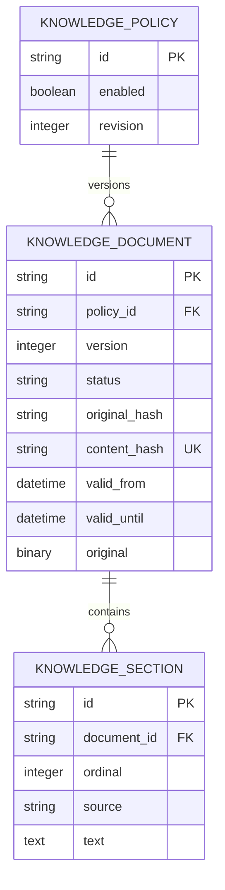

# C03 — Knowledge ingestion and lifecycle

## Runtime and administration

Run the existing setup/migration commands; Alembic revision `0004` creates the
knowledge tables. Configure `NORTHSTAR_ADMIN_TOKEN` with a private random value of
at least 32 characters in the ignored `.env`. Compose forwards it to the backend.
An unset/empty token disables administration (503). Incorrect bearer credentials
return 401 before reading the upload. This is the minimal administrative boundary;
user roles and identity management belong to C11. Never put tokens in URLs.

Upload a file (PowerShell uses `curl.exe`):

```powershell
curl.exe -H "Authorization: Bearer $env:NORTHSTAR_ADMIN_TOKEN" -F "policy_id=refund-policy" -F "file=@docs/policies/refunds.md" http://localhost:8000/api/admin/documents
```

| Method and path under `/api/admin/documents` | Contract |
| --- | --- |
| POST empty path | Multipart `file`, `policy_id`, optional `valid_from`, `valid_until` |
| POST `/policies/{policy_id}/versions` | Multipart `file`, optional validity timestamps; policy must exist |
| POST `/batch` | Repeated `files` and matching repeated `policy_ids`, in order; 1–10 new policies |
| GET empty path | Paginated metadata (`offset=0`, `limit=25`, maximum 100) |
| GET `/{document_id}` | Metadata, version, processing/lifecycle state, warnings, extracted sections |
| POST `/{document_id}/deactivate` | Disable one version; does not resurrect an older version |
| POST `/policies/{policy_id}/deactivate` | Disable all current and scheduled versions of a policy |

Individual requests allow one file up to 5 MiB and 64 KiB multipart overhead.
Batches allow 10 MiB total plus overhead, at most ten files, each up to 5 MiB.
Batch entries commit independently; the ordered response reports each result.
Dates use timezone-aware ISO 8601 timestamps. Omitted `valid_from` means now;
`valid_until`, if set, must be later. Unknown metadata is rejected.

A successful submission returns `{duplicate, document}`. Processing failures
return an inspectable document with `status: FAILED`, a safe error code and no
sections; HTTP 200 means the attempt was recorded, not that extraction succeeded.
For example, upload `broken.pdf` containing plain text to obtain `corrupt_pdf`.
Empty text produces `empty_document` or `empty_or_unreadable_text`. Validation,
authorization and request-size failures use the existing API error envelope.
A database write failure rolls back the entire attempt and returns the existing
generic 500 response; no READY document or partial sections remain. Retry after
resolving the storage failure. No PROCESSING row can be stranded by interruption.

## Model and invariants



Original bytes, sanitized basename, media type determined from supported format,
SHA-256 source fingerprint, normalized-content fingerprint, timestamps, warnings,
validity and sections commit together. Policy row locks serialize version numbers;
unique constraints protect concurrent first uploads and cross-policy duplicates.
Concurrent conflicts return 409 and may be retried after inspection.
Versions include failed attempts, so numbering can contain failed entries.

Normalized content is globally deduplicated, including inactive historical
versions. A repeated upload returns the existing document and does **not** apply
new policy identifiers, validity dates or activation changes. Inspect the returned
policy/version/lifecycle before using it. Historical content cannot be silently
republished under another policy. Replacements require a changed document.

Processing state is READY or FAILED. Lifecycle state is derived at read time:
ACTIVE, SCHEDULED, SUPERSEDED, EXPIRED, INACTIVE or FAILED. The highest successful
version whose effective time has arrived supersedes earlier versions permanently.
A failed or future replacement leaves the current version usable. Expiry or
individual deactivation of the new version does not restore obsolete policy.
Policy deactivation also blocks future scheduled versions. No worker or timer is
needed: eligibility changes at the timestamp boundary on the next query.

`retrieval.service.eligible_documents(at)` and `retrieval_sections(session, at)`
are the authoritative C04 integration boundary. Any future index must filter or
revalidate candidate document IDs with this predicate **at evidence use**, even
when chunks are cached. A static index must never treat READY as active. There is
no embedding provider or vector index in C03. The policy `revision` is an ingestion
sequence, not a complete index invalidation cursor.

Business seed/reset lists explicit business tables, leaving knowledge untouched.
No support-case state is stored in the knowledge tables.

## Extraction and references

UTF-8 Markdown/plain text and extractable, unencrypted PDF are supported. Unicode
NFC, newline normalization and trailing whitespace cleanup retain case, numbers,
negation, punctuation and Markdown syntax. Markdown headings and source line
positions, or PDF page numbers, are retained. Sections are at most 2,000 characters
with character offsets within their source unit; a long clause may span sections.
Consumers should include adjacent sections when needed. IDs are deterministic
within an immutable document version and remain stable across reads/duplicate uploads.

PDFs are limited to 200 pages, 5 MiB decoded page content, and one million extracted
characters. Short text, replacement characters and empty PDF pages trigger quality
warnings; empty/scanned-only, corrupt, encrypted and highly unreadable files fail.
These are heuristics, not guarantees of semantic extraction fidelity. Administrators
should inspect warned documents. PDFs with complex layout and OCR are out of scope.
The extractor follows [pypdf's text extraction guidance](https://pypdf.readthedocs.io/en/stable/user/extract-text.html),
including decoded page-stream checks. As documented upstream, decoding occurs before
the stream size can be checked; serve this endpoint only to trusted administrators
and use container memory limits for hostile-file isolation.

## Verification

`python -m pytest tests/test_knowledge.py -q` covers real text-bearing PDF, Markdown,
plain text, unsupported/corrupt/scanned/empty input, source references, duplicate
normalization, validity boundaries, failed replacement, deactivation, atomic rollback,
batch API, auth, size limits, inspection, quality warnings and reset isolation.
The full suite also verifies empty/legacy migrations, schema parity, packaged wheel
installation and rollback. PostgreSQL lifecycle/concurrency tests require
`NORTHSTAR_TEST_DATABASE_URL` pointing to an empty disposable PostgreSQL database.
Local SQLite tests do not constitute primary PostgreSQL runtime verification.
