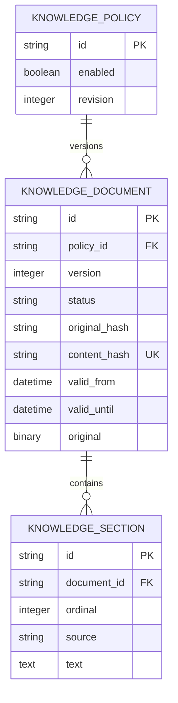

# Knowledge ingestion, storage and review

Current C/D contract: [DOCUMENT_REVIEW.md](DOCUMENT_REVIEW.md).

- Upload metadata now requires `title` and `sensitivity` in addition to `policy_id`.
- MinIO/S3 stores originals; PostgreSQL stores keys, sections, assessments and events.
- Extraction READY is independent of publication PENDING_REVIEW/APPROVED/REJECTED.
- Only human-approved PUBLIC versions are eligible for the current retrieval index.
- The review worker routes OpenAI/Ollama before any call, considering both revisions.
- The Stored documents frontend screen connects to the API; other screens are previews.
- Existing databases require the staged 0008 export / 0009 contract migration.

The following material records the earlier A/B implementation and its verification.
Where it describes binary storage, upload metadata, schema head or READY-based automatic
eligibility, it is superseded by the current C/D contract above.

---

# C03 — Knowledge ingestion and lifecycle

## Runtime and administration

Run the existing setup/migration commands; Alembic revision `0004` creates the
knowledge tables; revision `0007` adds extraction claims and byte-hash indexing.
Run `docker compose up --build --wait backend worker` to start the API and worker. Configure `NORTHSTAR_ADMIN_TOKEN` with a private random value of
at least 32 characters in the ignored `.env`. Compose forwards it to the backend.
An unset/empty token disables administration (503). Incorrect bearer credentials
return 401 before reading the upload. This is the minimal administrative boundary;
user roles and identity management belong to C11. Never put tokens in URLs.

Upload a file (PowerShell uses `curl.exe`):

```powershell
curl.exe -H "Authorization: Bearer $env:NORTHSTAR_ADMIN_TOKEN" -F "policy_id=refund-policy" -F "file=@docs/policies/refunds.md" http://localhost:8000/api/admin/documents
```

| Method and path under `/api/admin/documents` | Contract |
| --- | --- |
| POST empty path | Multipart `file`, `policy_id`, optional `valid_from`, `valid_until` |
| POST `/policies/{policy_id}/versions` | Multipart `file`, optional validity timestamps; policy must exist |
| POST `/batch` | Repeated `files` and matching repeated `policy_ids`, in order; 1–10 new policies |
| GET empty path | Paginated metadata (`offset=0`, `limit=25`, maximum 100) |
| GET `/{document_id}` | Metadata, version, processing/lifecycle state, warnings, extracted sections |
| POST `/{document_id}/deactivate` | Disable one version; does not resurrect an older version |
| POST `/policies/{policy_id}/deactivate` | Disable all current and scheduled versions of a policy |

Individual requests allow one file up to 5 MiB and 64 KiB multipart overhead.
Batches allow 10 MiB total plus overhead, at most ten files, each up to 5 MiB.
Batch entries commit independently; the ordered response reports each result.
Dates use timezone-aware ISO 8601 timestamps. Omitted `valid_from` means now;
`valid_until`, if set, must be later. Unknown metadata is rejected.

A valid submission returns `{duplicate, document}` with `status: QUEUED` (HTTP
200). The worker progresses it to PROCESSING and then READY, FAILED or DUPLICATE.
Poll `GET /{document_id}` for completion. Basic format/empty-file failures are
recorded immediately as FAILED; conversion failures are recorded by the worker.
Neither acceptance nor HTTP 200 means extraction succeeded.

The database queue survives restarts. Claims expire after 180 seconds, allowing a
replacement worker to recover work. Conversion runs in an isolated subprocess with
a 120-second timeout. After three interrupted claims the document fails explicitly.
Claim tokens prevent stale workers from publishing. Conversion errors/timeouts are
terminal; database errors leave the claim recoverable. Sections and READY commit in
one transaction. The synchronous internal ingestion path is retained for fixtures;
HTTP endpoints always enqueue. `python -m northstar.retrieval.worker --once` handles
at most one job, without requiring Redis or a task broker.

## Model and invariants



Original bytes, sanitized basename, media type determined from supported format,
SHA-256 source fingerprint, normalized-content fingerprint, timestamps, warnings,
validity and sections commit together. Policy row locks serialize version numbers;
unique constraints protect concurrent first uploads and cross-policy duplicates.
Concurrent conflicts return 409 and may be retried after inspection.
Versions include failed attempts, so numbering can contain failed entries.

SHA-256 byte hashes are looked up before extraction, including pending, failed
and historical records. Repeated bytes return the existing record without creating
another job or changing its policy. PostgreSQL transaction advisory locks serialize
same-byte submissions across policies; an indexed lookup supports existing data.

After extraction, normalized content is globally deduplicated. In the worker path,
a match becomes DUPLICATE with `duplicate_of` referencing the existing version and
no sections. A database unique constraint arbitrates concurrent normalized matches.
The synchronous fixture path continues to return the existing document directly.
Neither path silently creates version relationships or republishes historical content.

Processing states are QUEUED, PROCESSING, READY, FAILED and DUPLICATE. Lifecycle
states additionally distinguish ACTIVE, SCHEDULED, SUPERSEDED, EXPIRED and INACTIVE.
Only READY versions participate in eligibility. A queued, processing, failed or
duplicate replacement does not supersede the current successful policy. The highest
successful version whose effective time has arrived supersedes earlier versions
permanently. Expiry/deactivation never restores obsolete content. Policy deactivation
also blocks scheduled versions. Inspection reports attempts, errors and duplicate
references without exposing internal claim tokens.

`retrieval.service.eligible_documents(at)` and `retrieval_sections(session, at)`
are the authoritative C04 integration boundary. Any future index must filter or
revalidate candidate document IDs with this predicate **at evidence use**, even
when chunks are cached. A static index must never treat READY as active. C04 now consumes this boundary through its local semantic index; see RETRIEVAL.md. The policy `revision` is an ingestion
sequence, not a complete index invalidation cursor.

Business seed/reset lists explicit business tables, leaving knowledge untouched.
No support-case state is stored in the knowledge tables; revision `0007` adds extraction claims and byte-hash indexing.
Run `docker compose up --build --wait backend worker` to start the API and worker.

## Extraction and references

UTF-8 Markdown/plain text, extractable unencrypted PDF, and DOCX are supported.
TXT/MD uses direct decoding. PDF/DOCX uses Docling's pinned modular distribution
(`docling-slim`): the native PDF pipeline retains text-cell/page references without
OCR, learned layout/table reconstruction, remote services or model downloads; the
DOCX pipeline retains headings, items and table content. DOCX page numbers are not
invented when absent. PDF reading order follows native parser output; inspect complex
layouts before using their sections.

Unicode NFC, newline normalization and trailing whitespace cleanup retain case,
numbers, negation, punctuation and leading indentation. Markdown headings and line
positions, Docling item/page/heading references, and offsets are preserved. Sections
are at most 2,000 characters; IDs remain deterministic within an immutable revision.

Limits include 5 MiB uploaded bytes, 200 PDF pages, one million extracted characters,
and DOCX archive limits of 2,000 entries/25 MiB expanded data. The worker container
has a 1 GiB memory limit. Scanned-only/empty content, corrupt input and unreadable
text fail. Short or replacement-character-containing text receives quality warnings.
The ingestion path never creates embeddings.

Docling references: [native PDF pipeline](https://docling-project.github.io/docling/usage/advanced_options/)
and [modular package configuration](https://github.com/docling-project/docling/blob/main/pyproject.toml).

## Verification

`python -m pytest tests/test_knowledge.py tests/test_extraction_worker.py -q` covers real text-bearing PDF, DOCX with headings/tables, Markdown,
plain text, worker restart/recovery, claim fencing and transaction rollback, unsupported/corrupt/scanned/empty input, source references, duplicate
normalization, validity boundaries, failed replacement, deactivation, atomic rollback,
batch API, auth, size limits, inspection, quality warnings and reset isolation.
The full suite also verifies empty/legacy migrations, schema parity, packaged wheel
installation and rollback. PostgreSQL lifecycle/concurrency tests require
`NORTHSTAR_TEST_DATABASE_URL` pointing to an empty disposable PostgreSQL database.
Local SQLite tests do not constitute primary PostgreSQL runtime verification.
