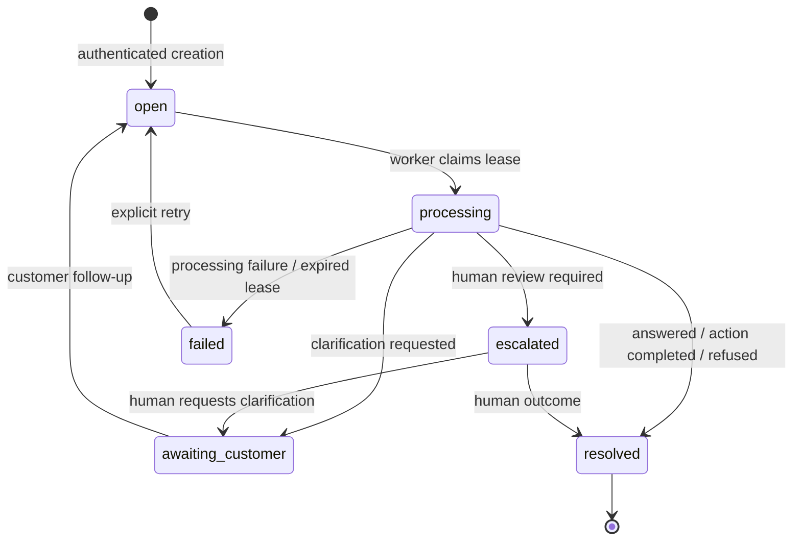
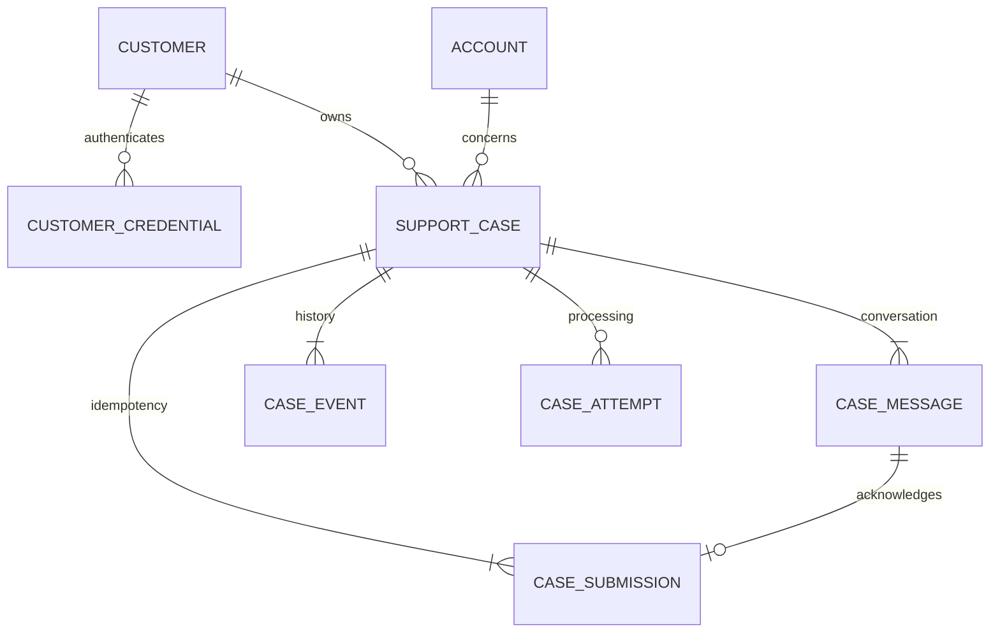

# C05 — Support request API and case lifecycle

## Boundaries and authentication

Apply migration `0006` using the normal Alembic startup process. It adds cases,
ordered messages, lifecycle events, processing attempts, submission receipts and
customer credentials. Business and knowledge records remain separate. Cases have
a composite foreign key to the correct account/customer association.

Customer authentication uses random 256-bit opaque bearer tokens. Only SHA-256
hashes are stored. Credentials expire, can be revoked and are issued out of band
by an authorized operator; there is no public credential-issuance endpoint.

From `backend`, with the configured database and existing synthetic customers:

```powershell
..\.venv\Scripts\python.exe -m northstar.cases.credentials issue alice --hours 24
..\.venv\Scripts\python.exe -m northstar.cases.credentials revoke CREDENTIAL_ID
```

The issue command prints the token once. Keep it private; send it only in the
Authorization header over HTTPS outside local development. The customer ID is
resolved from that credential, never accepted from request JSON or query metadata.
An invalid, expired or revoked token returns 401. Unknown and other-customer cases
both return 404. A customer credential cannot call administrator endpoints.
The existing `NORTHSTAR_ADMIN_TOKEN` authorizes the single administrator boundary.
Full operator identities, account login flows and role management remain in C11.

## Customer API

| Method / path | Inputs and behavior |
| --- | --- |
| POST `/api/cases` | `Idempotency-Key`; account_id, subject, message, optional category/context; returns case_id, message_id, replayed |
| GET `/api/cases` | Optional status, category, account_id, limit and offset; only owned cases |
| GET `/api/cases/{id}` | Current state, latest disposition, version, context, counts, timestamps and safe failure code |
| POST `/api/cases/{id}/messages` | `Idempotency-Key`; message and expected_version |
| POST `/api/cases/{id}/retry` | expected_version; explicitly reopen a failed case |
| GET `/api/cases/{id}/messages` | Ordered conversation with roles and timestamps |
| GET `/api/cases/{id}/events` | Ordered state/outcome history, actor category and related references |
| GET `/api/cases/{id}/attempts` | Processing lease, start/end times, safe error and result history |

Lists/history use `limit=25`, maximum 100, with nonnegative offset. Category is one
of general, billing, account, technical or privacy. Categorization is submitted
metadata, not an AI classification feature. Context accepts only an optional
`invoice_id` (validated against the owned account) and `client_reference`.
Subjects are 1–200 characters; messages are 1–8,000 nonblank characters. JSON
bodies are capped at 64 KiB before validation. Unknown fields, invalid types and
unsupported states fail without partial persistence.

Example create JSON:

```json
{
  "account_id": "alice-active",
  "subject": "Invoice explanation",
  "message": "Can you explain my latest invoice?",
  "category": "billing",
  "context": {"invoice_id": "inv-eligible", "client_reference": "portal-123"}
}
```

Example PowerShell request, with a privately provisioned token:

```powershell
$headers = @{ Authorization = "Bearer $env:NORTHSTAR_CUSTOMER_TOKEN"; "Idempotency-Key" = "portal-request-123" }
$body = @{ account_id = "alice-active"; subject = "Invoice explanation"; message = "Can you explain my invoice?"; category = "billing" } | ConvertTo-Json
Invoke-RestMethod -Method Post -Uri http://localhost:8000/api/cases -Headers $headers -ContentType application/json -Body $body
```

Creation and follow-up return submission receipts. Replays return the original IDs
with `replayed: true`; read the case endpoint for its current state. Keys are scoped
to the authenticated customer across case creation and follow-ups. A reused key
with changed operation, target case or validated payload returns 409. For a retry of
the same HTTP submission, retain both its key and expected_version. A conflicting
new submission must reload the case and use its current version.

## Lifecycle and processing



Open cases may accept additional messages. Escalated cases may accept additional
customer information while remaining escalated. Processing, failed and resolved
cases reject new messages; failed cases must first be retried. A new question after
resolution requires a new case. All state changes and their history commit together.
The latest disposition remains available when a follow-up reopens a case; it is
historical outcome metadata, not a replacement for the current status.

`CaseService` is the trusted internal C07/C10 integration boundary:

- `start_processing(case_id, lease_seconds=60)` atomically changes open → processing
  and returns a unique attempt ID and expiry. Lease bounds are 1–900 seconds.
- `complete(case_id, attempt_id, Outcome(...))` records a reply, disposition,
  decision/action/escalation references and the resulting state atomically.
  Repeating an identical completion is idempotent; conflicting results are rejected.
- `fail(case_id, attempt_id, error_code)` records an explicit failure. Allowed safe
  codes are processing_failed, provider_unavailable, retrieval_failed and invalid_result.
- `recover_expired(limit=100)` marks expired attempts timed_out and cases failed with
  processing_interrupted. An old attempt cannot complete a newer processing cycle.
- `human_review(case_id, expected_version, outcome)` accepts only escalated cases
  and resolves them or requests customer clarification.

These methods **do not run a model or execute a business action**. They persist
outcomes supplied by trusted callers. Action-completed outcomes require an action
reference. Related action, decision and escalation identifiers remain opaque until
the corresponding later features supply their records; a stored disposition is
not independent proof that a business mutation occurred.

PostgreSQL row locks serialize claims and transitions; customer locks serialize
submission keys across cases. Follow-ups and human reviews require version checks
so concurrent updates cannot silently overwrite each other. SQLite is supported
only for local tests, not as the production concurrency implementation.

## Restart and timeout recovery

Leases and attempt IDs survive process restarts. Restarting does not assume every
processing case is abandoned: a live worker may still own an unexpired lease.
After expiry, case inspection, history reads and customer listing recover the
relevant records. Administrators can explicitly sweep up to 100 expired cases per
request with `POST /api/admin/cases/recover`. Repeat the bounded sweep if needed.
A failed case remains visible until an explicit version-checked retry reopens it.
There is no background scheduler, automatic model execution or automatic action retry.

C07 must process work within its lease and pass the returned attempt ID to finish.
C08 must use durable business-operation idempotency when retrying work that might
have executed an action before a crash; a processing lease cannot undo an external
side effect. C05 fences stale **case writes** and records the interrupted attempt.
It does not claim distributed exactly-once action execution.

## Administrator review

The existing administrator bearer credential permits:

- GET `/api/admin/cases/{id}` and `/{id}/messages`, `/events`, `/attempts` to inspect
  a case and obtain its current version.
- POST `/api/admin/cases/{id}/review` with expected_version, disposition, reply and
  optional action_id/decision_id/escalation_id. Only escalated cases are eligible;
  the disposition must resolve the case or request clarification.
- POST `/api/admin/cases/recover` for bounded lease recovery.

Customers cannot claim processing, submit outcomes, perform human review or invoke
recovery sweeps. C10's review queue and assignment UI are not implemented here.

## Persistence and reset safety



Cases store creation/update/resolution times; messages have a unique per-case
sequence, and events have a unique per-case version. Attempts retain start, lease
expiry, completion, errors and outcomes. Safe codes are stored instead of arbitrary
exception strings that might contain credentials. Tokens and Authorization headers
are never added to cases, conversation history or logs.

C02's business reset cannot delete accounts/customers referenced by cases or
credentials: the transaction fails and preserves both business and support records.
Use a separate disposable database for evaluation initialization rather than
silently deleting case history. No cascade destroys support history.

## Portfolio proof and verification

From the repository root:

```powershell
.\.venv\Scripts\python.exe scripts/case_demo.py
```

The demo creates a disposable SQLite test database, seeds synthetic customers,
issues an ephemeral credential (not printed), calls the real customer API, replays
a submission, simulates trusted processor outcomes and prints the persisted
conversation and lifecycle history. The resulting states are open → processing →
awaiting_customer → open → resolved. Its fixed replies demonstrate persistence,
not AI execution. A captured run is in [the case demo output](../examples/case-demo.json).

`backend/tests/test_cases.py` covers valid/invalid requests, ownership, credential
expiry/revocation, idempotency, stale versions, terminal-case rejection, clarification,
escalation/human review, timeout/restart recovery, atomic rollback, category/status
filtering, database relationship constraints and reset safety. PostgreSQL tests cover
competing creations/claims and follow-ups. The full suite also tests empty/legacy
migrations, downgrade, schema parity and installed-wheel startup. Skipped PostgreSQL
tests remain unverified until a disposable primary database is available.
