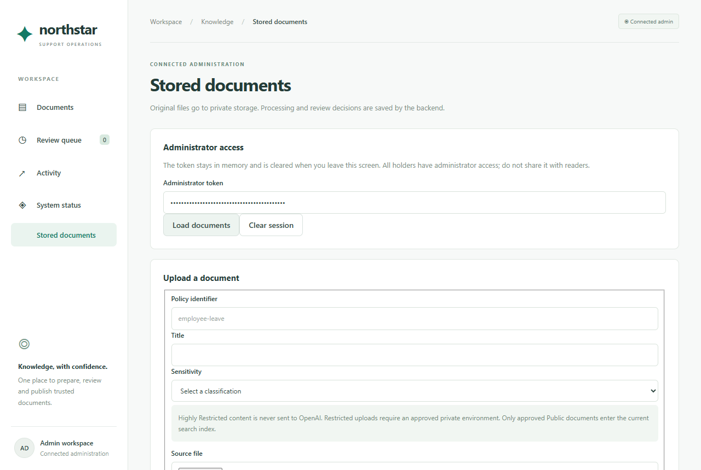
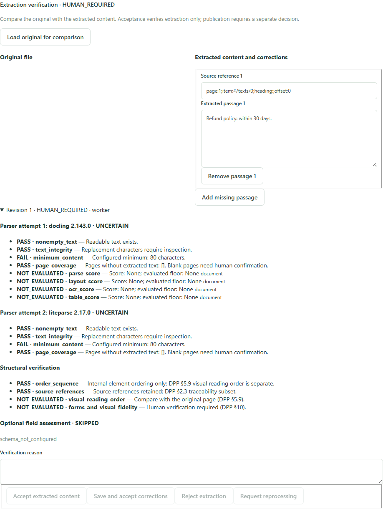
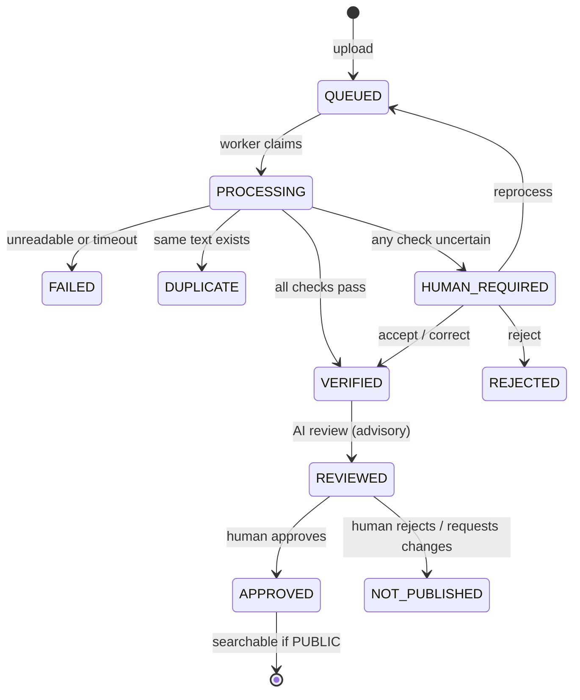

# Usage guide

How to take a document from upload to publication, in the browser or through the API.
Start the app first ([SETUP.md](SETUP.md)).

## In the browser

Open **Stored documents**, paste the administrator token, then click **Load documents**.



1. **Upload** with a policy ID, title and sensitivity level.
2. **Refresh** until the worker finishes. *Extraction verification* shows each parser
   attempt with its quality checks, the structure checks, the field assessment, and
   highlighted passages that need attention.
3. If the status is `HUMAN_REQUIRED`, compare with the original, then **accept**,
   **correct** (edit passages), **reject** or **request reprocessing**. A reason is required.
4. Once extraction is `VERIFIED`, the worker runs the AI review. Refresh to see it.
5. **Human decision:** approve, reject or request changes, with a reason. Approval is
   refused until extraction is verified and the review has finished.



## With the API

```powershell
$token = $env:NORTHSTAR_ADMIN_TOKEN
$headers = @{ Authorization = "Bearer $token" }
$base = "http://localhost:8000/api/admin/documents"

# Upload a new policy (use .../policies/<policy_id>/versions for a replacement)
$file = Join-Path $env:TEMP "leave-policy.md"
Set-Content -Encoding utf8 $file "# Employee leave policy`nEmployees may request 20 days of annual leave. Managers review requests before leave begins."
$upload = curl.exe -sS -H "Authorization: Bearer $token" -F "policy_id=employee-leave" `
  -F "title=Employee leave" -F "sensitivity=PUBLIC" -F "file=@$file" $base | ConvertFrom-Json
$id = $upload.document.id

# Inspect: status, extraction history, sections, assessments, events
$doc = Invoke-RestMethod "$base/$id" -Headers $headers
$doc | Select-Object status, extraction_status, extraction_revision, review_status, publication_status

# Human extraction verification: ACCEPT | CORRECT (with corrections) | REJECT | REPROCESS
$body = @{ decision = "ACCEPT"; reason = "Compared with the original"; revision = $doc.extraction_revision } | ConvertTo-Json
Invoke-RestMethod "$base/$id/verification" -Method Post -Headers $headers -ContentType application/json -Body $body

# Publication decision: APPROVED | REJECTED | CHANGES_REQUESTED | DELETED
$body = @{ decision = "APPROVED"; reason = "Reviewed" } | ConvertTo-Json
Invoke-RestMethod "$base/$id/decision" -Method Post -Headers $headers -ContentType application/json -Body $body
```

| Method and path | Purpose |
| --- | --- |
| `POST /api/admin/documents` | Upload a new policy |
| `POST /api/admin/documents/policies/{policy_id}/versions` | Upload a replacement version |
| `POST /api/admin/documents/batch` | Up to 10 files: repeat `files`, `policy_ids`, `titles`, `sensitivities` in matching order |
| `GET /api/admin/documents?offset=0&limit=25` | List versions |
| `GET /api/admin/documents/{id}` | Inspect one version |
| `GET /api/admin/documents/{id}/original` | Download the original file |
| `POST /api/admin/documents/{id}/verification` | Human extraction decision |
| `POST /api/admin/documents/{id}/decision` | Human publication decision |
| `POST /api/admin/documents/{id}/deactivate` | Deactivate a version |
| `POST /api/admin/documents/policies/{policy_id}/deactivate` | Deactivate a whole policy |

**HTTP 200 on upload means the file was recorded, not that extraction succeeded.**
Always check `status` and `extraction_status`. Full schemas: http://localhost:8000/docs.

## Status values

| Field | Values |
| --- | --- |
| `status` | `QUEUED` → `PROCESSING` → `READY` / `FAILED` / `DUPLICATE` |
| `extraction_status` | `PENDING`, `VERIFIED`, `HUMAN_REQUIRED`, `REJECTED` |
| `review_status` | `PENDING` → `PROCESSING` → `DONE` |
| `publication_status` | `PENDING_REVIEW`, `APPROVED`, `REJECTED`, `CHANGES_REQUESTED`, `DELETED` |



## Rules and limits

- **Size:** 5 MiB per file; batches of up to 10 files and 10 MiB.
- **Policy IDs:** lowercase letters, digits, `_` and `-`, up to 100 characters.
- **Validity dates:** `valid_from` and `valid_until` are optional and need a timezone.
- **Versions:** replacements always target a policy explicitly; hash or title matches
  never create a version link. A repeated identical file returns the existing record
  (`duplicate: true`). A replacement can't lower the sensitivity.
- **Failures:** a failed, pending or rejected replacement leaves the current approved
  version in place.
- **Worker:** three-minute claims, a two-minute conversion timeout, at most three
  attempts. A crashed worker's claim is recovered automatically.

What to expect from extraction: TXT/MD files that pass the checks verify automatically.
PDF and DOCX always need a human because visual checks can't be automated. With OCR off,
Docling also has no OCR score, so every PDF goes through LiteParse as well. Scanned-only,
corrupt and encrypted PDFs fail.

## Evaluate the AI classifier

```powershell
cd backend
# Validate a dataset without calling any model
..\.venv\Scripts\python.exe -m northstar.evaluation.document_review tests/fixtures/document_review_draft.jsonl --output ../evaluation-results/dry-run.json --dry-run
# After the labels are human-verified, with a provider configured
..\.venv\Scripts\python.exe -m northstar.evaluation.document_review path/to/reviewed.jsonl --output ../evaluation-results/run.json
```

The report gives the confusion counts, recall and precision on completed runs, coverage,
schema and evidence validity, latency percentiles and an optional token-cost estimate.
See [DOCUMENT_REVIEW.md](../architecture/DOCUMENT_REVIEW.md).
